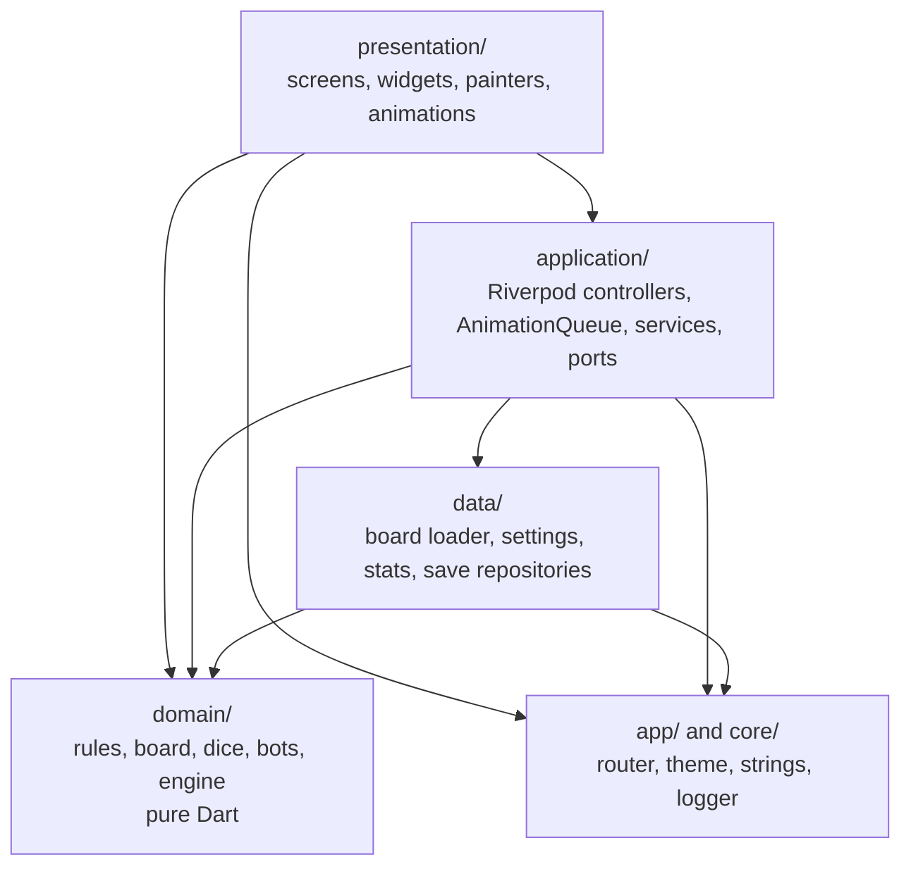
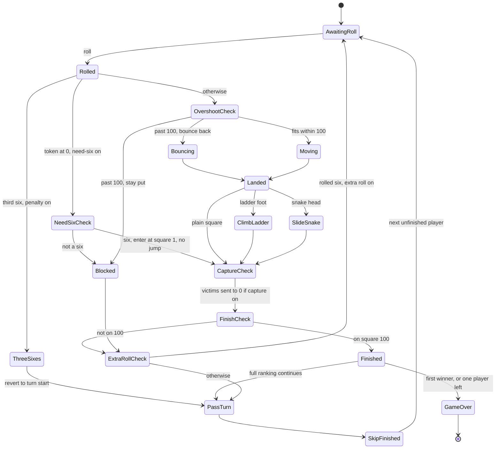
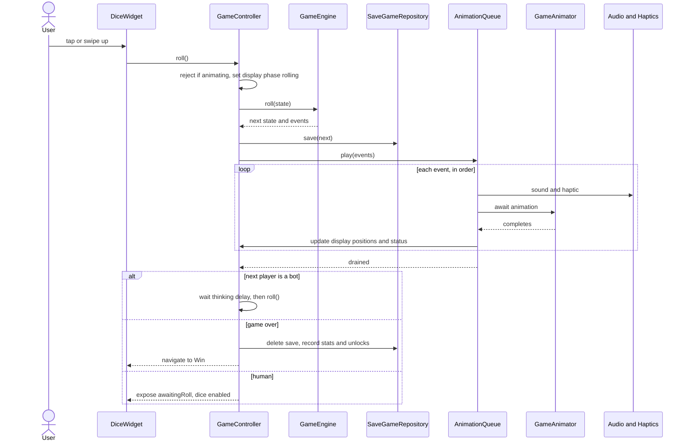
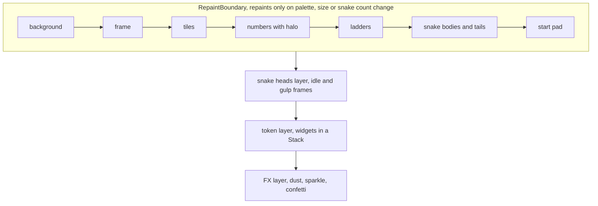
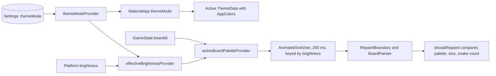

# Snake Saga — Architecture

Phase 1 deliverable. Dart package `snake_ladder`, Flutter for Android and iOS, portrait only.
Every decision and every change from the build brief is logged in [DECISIONS.md](DECISIONS.md).

## 1. Stack

### 1.1 Verified package set

These versions were resolved on the installed toolchain (Flutter 3.41.6, Dart 3.11.4). A throwaway project using them passed `build_runner`, `flutter analyze` with the Riverpod lint plugin active, `flutter test` and `flutter build apk --debug`.

| Purpose | Package | Version |
|---|---|---|
| State | `flutter_riverpod` | 3.3.1 |
| State codegen | `riverpod_annotation` / `riverpod_generator` | 4.0.2 / 4.0.3 |
| Riverpod lints | `riverpod_lint` (analyzer plugin) | 3.1.3 |
| Models | `freezed` / `freezed_annotation` | 3.2.5 / 3.1.0 |
| JSON | `json_serializable` / `json_annotation` | 6.13.0 / 4.11.0 |
| Codegen runner | `build_runner` | 2.15.1 |
| Navigation | `go_router` | 17.5.0 |
| Persistence | `shared_preferences` / `path_provider` | 2.5.6 / 2.1.6 |
| Audio | `audioplayers` | 6.7.1 |
| SVG | `flutter_svg` | 2.3.3 |
| UI motion | `flutter_animate` | 4.5.2 |
| Lints | `very_good_analysis` | 10.2.0 |
| Tests | `flutter_test`, `mocktail`, `alchemist` | SDK, 1.0.5, 0.14.1 |
| Brand tooling | `flutter_launcher_icons` / `flutter_native_splash` | 0.14.4 / 2.4.7 |

Three changes from the brief were forced by the toolchain:

1. **`custom_lint` is dropped.** Every `riverpod_lint` release that fits this SDK is incompatible with `custom_lint` once `freezed_annotation` 3 is in the graph. Current `riverpod_lint` no longer uses `custom_lint`; it is an analyzer plugin enabled under `plugins:` in `analysis_options.yaml`, and its diagnostics appear directly in `flutter analyze`.
2. **Riverpod is held at the versions above.** Flutter 3.41.6 pins `meta` to 1.17.0, and later `riverpod_generator` releases need `meta` 1.18 or Dart 3.12.
3. **Minimum Android is API 24, not 23.** The Flutter 3.41.6 Android engine declares `minSdkVersion="24"`, and the Flutter tool has a migration that rewrites any `minSdk` of 23 or lower. Reaching API 23 would mean downgrading Flutter.

`SemanticsService.announce` is deprecated in this Flutter, so the app uses `SemanticsService.sendAnnouncement(View.of(context), …)` to keep analysis at zero warnings.

### 1.2 Why not Flame

Flame's value is a fixed-rate game loop, a component tree, collision and a camera. This game has none of those needs: nothing moves unless a player rolls, the board never scrolls, and every motion is a finite animation with a known start and end. Flutter's `AnimationController` expresses that directly and gives `Future`s the animation queue can await. A static board in a `RepaintBoundary` costs nothing per frame, while a game loop would redraw the scene continuously and drain battery on a screen that is mostly idle. Staying in widgets also gives us accessibility semantics, text layout, theming and golden tests with no bridge code.

## 2. Layers

The brief's listing places `data/` below `domain/`, but `domain/` must be pure Dart and `data/` needs Flutter (`rootBundle`, `shared_preferences`, `path_provider`). So `domain/` is the innermost layer and `data/` depends on it. Dependencies still only point one way.



| Layer | May import | May not import |
|---|---|---|
| `domain/` | `dart:*`, `freezed_annotation`, `json_annotation`, `meta` | Flutter, any other layer |
| `data/` | `domain/`, `core/`, Flutter services, storage plugins | `application/`, `presentation/` |
| `application/` | `domain/`, `data/`, `core/`, Riverpod, Flutter services | `presentation/`, Flutter widgets |
| `presentation/` | `application/`, `domain/`, `app/`, `core/` | `data/` |

`AnimationQueue` lives in `application/`, but animations belong to widgets. It therefore talks to a `GameAnimator` port that `presentation/` implements, which is also what makes the "fake animation queue" tests possible.

`test/architecture_test.dart` scans imports and fails on any violation of this table. It also fails if `lib/presentation` contains a literal `Color(0x…)` or `Colors.*` other than `Colors.transparent`.

## 3. Folder structure

```
lib/
  main.dart
  app/
    app.dart  router.dart  strings.dart
    theme/    app_theme.dart  app_colors.dart  board_palette.dart  board_theme.dart
              typography.dart  spacing.dart  contrast.dart
  core/       constants.dart  extensions.dart  result.dart  logger.dart
  domain/
    board/    board.dart  jump.dart  offset01.dart  unlock_rule.dart  board_validator.dart  coords.dart
    dice/     dice.dart  random_dice.dart  fixed_dice.dart
    rules/    rule_set.dart  move_resolver.dart
    game/     game_state.dart  player.dart  player_stats.dart  game_event.dart  game_engine.dart  game_setup.dart
    bots/     bot_strategy.dart  easy_bot.dart  normal_bot.dart
  data/
    boards/   board_repository.dart  board_theme_repository.dart
    settings/ settings_repository.dart  app_settings.dart
    stats/    stats_repository.dart  lifetime_stats.dart
    save/     save_game_repository.dart
  application/
    game_controller.dart  game_view_state.dart  animation_queue.dart
    audio_service.dart  haptics_service.dart  unlocks_service.dart
    settings_controller.dart  theme_providers.dart  asset_preloader.dart
    ports/    game_animator.dart  ad_gate.dart
  presentation/
    splash/ home/ mode_select/ player_setup/ board_select/ pause/ win/ settings/ how_to_play/ stats/
    game/     game_screen.dart  board_game_animator.dart
      widgets/ board_view.dart  board_painter.dart  snake_painter.dart  snake_heads_layer.dart
               ladder_painter.dart  jump_geometry.dart  token_layer.dart  token_widget.dart
               dice_widget.dart  player_strip.dart  status_line.dart  fx_layer.dart  overlays.dart
    common/   buttons.dart  panels.dart  dialogs.dart  toasts.dart  mini_board.dart
assets/       boards/ themes/ images/ sprites/ icons/ audio/ fonts/ manifest.json
tool/         export_assets.py  synth_audio.py
test/         architecture_test.dart  domain/ application/ presentation/ goldens/ assets/
docs/         ARCHITECTURE.md  DECISIONS.md
design/       wireframes.html  asset_library.html
ref/          classic_board_reference.png
```

## 4. Domain model

All models are `freezed` and JSON-serialisable.

```dart
enum JumpType { snake, ladder }
enum TokenColor { red, blue, green, yellow }      // symbols: ★ ● ▲ ■ in this order
enum PlayerKind { human, bot }
enum BotLevel { easy, normal }
enum OvershootRule { stayPut, bounceBack }
enum PlayTo { firstWinner, fullRanking }
enum BlockReason { overshoot, needSix }
enum GameMode { vsComputer, passAndPlay, quickPlay }
enum TurnPhase { awaitingRoll, rolling, moving, resolvingJump, turnEnded, gameOver }

class Offset01 { double x; double y; }             // 0..1, y down; no dart:ui dependency

class Jump {
  String id; JumpType type; int from; int to;
  int? rank;                  // 1..8, snakes only
  List<Offset01> path;        // interior control points; empty for ladders
}

sealed class UnlockRule { none; wins(int count); }

class BoardDef {
  String id; String name;
  String themeId;             // JSON key: "theme"
  int size;                   // 10
  List<Jump> jumps;
  UnlockRule unlock;
  List<Jump> activeJumps(int snakeCount);  // all ladders + snakes with rank <= snakeCount
}

class RuleSet {
  bool needSixToStart;        // false
  OvershootRule overshoot;    // stayPut
  bool extraRollOnSix;        // true
  bool threeSixesPenalty;     // true
  bool capture;               // false
  PlayTo playTo;              // firstWinner
}

class PlayerStats { int turns; int ladders; int snakes; int longestClimb; int worstSlide; }

class Player {
  String id; String name; TokenColor color;
  PlayerKind kind; BotLevel? botLevel;
  int position;               // 0..100
  int? finishedRank; PlayerStats stats;
}

class GameState {
  int schemaVersion; GameMode mode;
  String boardId; RuleSet rules; List<Player> players;
  int currentPlayerIndex;
  int snakeCount;             // 6..8, default 7
  TurnPhase phase; int? lastRoll;
  int consecutiveSixes; int turnStartPosition; int turnNumber;
  int rngSeed; int rngCallCount;
  List<String> ranking;       // player ids in finishing order
  List<GameEvent> history;    // most recent 256 events
}

sealed class GameEvent {
  DiceRolled(int value);
  TokenStepped(String playerId, int from, int to);
  JumpTaken(String playerId, Jump jump);
  MoveBlocked(String playerId, BlockReason reason);
  Bounced(String playerId, int from, int to);
  Captured(String by, String victim);
  ExtraRollGranted();
  ThreeSixesPenalty(String playerId, int revertTo);
  PlayerFinished(String playerId, int rank);
  TurnPassed(String nextPlayerId);
  GameOver(List<String> ranking);
}
```

Clarifications:

- **`Jump.path` holds interior points only.** The curve runs through `[headCentre, ...path, tailCentre]`, as §5.5 of the brief defines. The §3.4 sample path ends on the tail centre, which would duplicate a point, so the bundled JSON will not do that.
- **Snake art is chosen from rank.** Design letter = `'abcd'[(rank - 1) % 4]`, so the board JSON schema needs no new field.
- **`GameState.phase` at rest is only ever `awaitingRoll` or `gameOver`,** because the engine resolves a whole roll atomically. `rolling`, `moving`, `resolvingJump` and `turnEnded` are display phases exposed through `GameViewState` while the queue plays.
- **`history` is capped at 256 events** so saves stay small and the 90,000-game simulation stays fast. Any complete game can still be replayed from `rngSeed`.
- **A "turn"** starts at the first roll and includes its extra rolls. `Player.stats.turns` counts these, and `GameState.turnNumber` is the total across all players.

## 5. Engine contract

```dart
abstract interface class Dice {
  int face({required int seed, required int index});   // 1..6, stateless
}

class GameEngine {
  GameEngine({required BoardDef board, required Dice dice});
  (GameState next, List<GameEvent> events) roll(GameState state);
}
```

`roll` has no timers, no I/O and no Flutter. The same engine and state always give the same result.

**Dice are counter-based.** The brief asks for a seeded `Random` plus `rngSeed` and `rngCallCount`. A stateful `Random` would make `roll` impure, and Dart does not guarantee `Random(seed)` stays identical across SDK versions, which would break old saves and a future server. `RandomDice` instead computes `face = f(seed, index)` with a small SplitMix64 hash and rejection sampling. `rngCallCount` is the index, so resume needs no fast-forwarding. `FixedDice([...])` simply returns `list[index]`.

### 5.1 Roll algorithm

1. Read `face` at index `rngCallCount`, then increment the count. Emit `DiceRolled`.
2. If `consecutiveSixes == 0`, this is the first roll of the turn: capture `turnStartPosition` and add one to `stats.turns`.
3. Update `consecutiveSixes`. If extra rolls and the penalty are both on and the count reaches 3: restore `turnStartPosition`, emit `ThreeSixesPenalty`, end the turn.
4. If the token is at 0 and need-a-6 is on: on anything but a 6, emit `MoveBlocked(needSix)` and end the turn. On a 6, step to square 1 (`kNeedSixEntersAtSquareOne` switches this to a normal 6-square move).
5. Otherwise, if the roll overshoots 100:
   - Stay put: emit `MoveBlocked(overshoot)`.
   - Bounce: emit `TokenStepped` up to 100, then `Bounced(100, target)`, then `TokenStepped` back to the target.
6. Otherwise emit one `TokenStepped` per square.
7. If the token moved by a normal or bounced move and its final square starts an active jump, apply it and emit `JumpTaken`. Entering at square 1 through need-a-6 never triggers a jump.
8. If capture is on and the final square is not 100, send every unfinished opponent on that square to 0 and emit `Captured` for each.
9. If the token is on 100: assign a rank and emit `PlayerFinished`. In first-winner mode emit `GameOver`. In full-ranking mode, when one player remains, rank them last and emit `GameOver`.
10. If the player has not finished, rolled a 6 and extra rolls are on: emit `ExtraRollGranted` and keep the same player. Otherwise reset `consecutiveSixes`, emit `TurnPassed` to the next unfinished player and increment `turnNumber`.

Edge cases, fixed here so tests can assert them:

- A 6 that is blocked by overshoot still grants the extra roll, since the rule is "rolling a 6 gives another roll".
- The third 6 does not move the token.
- A capture made earlier in a turn stands even if the three-6s penalty later reverts the mover.
- A finishing 6 grants no extra roll.

### 5.2 Turn state machine



### 5.3 Bots

```dart
abstract interface class BotStrategy {
  Duration thinkingDelay({required bool fast});
  BotAction chooseAction(GameState state);   // v1 always returns BotAction.roll
}
```

Easy waits 900 ms and Normal 600 ms, halved in Fast mode. No current rule gives a player a choice, so in v1 the delay is the only behavioural difference between levels. `chooseAction` is the seam for future rules that offer one.

## 6. Board coordinates

```
square n (1..100) → row      = (n - 1) ~/ 10            // 0 = bottom row
                    colInRow = (n - 1) % 10
                    col      = row.isEven ? colInRow : 9 - colInRow
                    centre   = Offset01((col + 0.5) / 10, 1 - (row + 0.5) / 10)
```

Worked example, square 47: `row = 46 ~/ 10 = 4`, `colInRow = 6`, row 4 is even so `col = 6`, centre = `(0.65, 0.55)`.
Odd row, square 16: `row = 1`, `colInRow = 5`, `col = 9 - 5 = 4`, centre = `(0.45, 0.85)`.
Square 100: `row = 9`, `colInRow = 9`, `col = 0`, centre = `(0.05, 0.05)`, the top-left cell.

Position 0 is drawn on a start pad just under square 1, outside the tile grid. Tokens sharing a square are offset by a fraction of a tile and scaled by count: 1 token is centred at 100%, 2 sit side by side at 80%, and 3–4 form a 2×2 cluster at 65%.

## 7. Presentation and engine flow



`GameViewState` carries the committed `GameState`, the display phase, per-player display positions, the status line and the active overlay. Widgets render display positions, so tokens and the player strip update square by square even though the engine has already finished.

| Event | Animation | Sound and haptic |
|---|---|---|
| `DiceRolled` | 700 ms tumble and bounce | `dice_shake`, `dice_land`, tick |
| `TokenStepped` | 180 ms hop (90 ms Fast) | `hop` |
| `JumpTaken` ladder | Climb the rail line, 120 ms per rung, max 1.2 s | `ladder_climb` |
| `JumpTaken` snake | Follow body path, 1.0–1.6 s by length, head gulp | `snake_gulp`, `snake_slide` |
| `MoveBlocked` | Shake and status line | `blocked` |
| `Bounced` | Badge | `blocked` |
| `Captured` | Victim hops to start pad | `capture` |
| `ExtraRollGranted` | Toast | `extra_roll` |
| `ThreeSixesPenalty` | Toast, token returns | `blocked` |
| `PlayerFinished` | Confetti, or static badge under reduce motion | `win_fanfare` |
| `TurnPassed` | Banner in Pass & Play, strip highlight moves | none |

With reduce motion on (`MediaQuery.disableAnimations`), hops become one quick slide and confetti is replaced by a static badge.

## 8. Rendering

`BoardView` is a `LayoutBuilder` producing a square of side `min(width - 32, height * 0.62, 640)`.



- **Snake heads get their own thin layer.** The gulp animation would otherwise invalidate the cached board on every frame.
- **Tapered bodies are built as filled ribbons.** Flutter strokes have constant width, so `SnakePainter` samples the path with `PathMetric.getTangentForOffset`, offsets along the normal by the interpolated half-width (0.16 tile at the head, 0.06 at the tail), and fills the polygon. Outline, belly highlight and pattern are drawn inside a `saveLayer` at 85% opacity so overlaps do not double up.
- **One geometry source.** `jump_geometry.dart` builds the Catmull-Rom `Path` once per jump and size. It must match `toBeziers` in `tool/wireframes/geometry.mjs`: uniform Catmull-Rom through `[head, ...path, tail]` with the end points duplicated, each span becoming the cubic `p1, p1 + (p2 − p0)/6, p2 − (p3 − p1)/6, p2`. The board layouts were validated against that exact curve. Both the painter and the slide animation use it, so tokens follow exactly what is drawn.
- **Tiles** are filled from `BoardPalette`, and the tile sprite is drawn on top once decoded.
- **Sprites in painters** need decoded `ui.Image`s. `asset_preloader.dart` resolves them through `AssetImage` with the device pixel ratio during Splash, which keeps 2.0x and 3.0x selection working.
- **Ladders** have rails at ±0.18 tile from the centre line and rungs about every 0.45 tile, with a drop shadow.
- **Phones under 360 dp** wrap the board in an `InteractiveViewer` with a maximum scale of 2, reset each turn.

## 9. Save, resume and lifecycle

- **Autosave happens as soon as the engine returns, before animating.** This is stricter than "after every turn": if the app dies mid-animation, only the animation is lost, never the roll.
- A saved game is one JSON file holding `GameState`. A parse failure or unknown `schemaVersion` discards it quietly and logs.
- Home shows Continue when a valid save exists. The save is deleted on game over and on confirmed quit.
- A resumed game always starts from `awaitingRoll`. If it is a bot's turn, the controller schedules that bot.
- `AppLifecycleListener` pauses music and bot timers in the background. Animations stop on their own when frames stop, and the queue continues on return.

## 10. Boards, unlocks and snake count

- Board JSON is loaded from `assets/boards/`. `BoardValidator` runs under `assert` in debug builds and in tests for all three boards at N = 6, 7 and 8.
- `GameState.snakeCount` is set in Player Setup, with its default from Settings (clamped to 6–8). The engine and painters read jumps only through `activeJumps(snakeCount)`.
- Quick Play uses Classic Sunshine, `RuleSet()` defaults regardless of saved house rules, and the Settings default snake count.
- The selected board is chosen in Board Select and remembered. Mode Select then Player Setup uses it.
- `UnlocksService` compares lifetime wins with each board's `UnlockRule`. A win is any completed game whose first finisher is a human, in any mode. Lifetime stats persist the result.

## 11. Theming

One `AppColors` token set builds light and dark `ThemeData`. Each board has a `BoardTheme` with a light and a dark `BoardPalette`, loaded from `assets/themes/{theme}.json`. Both are `ThemeExtension`s with `lerp`.



- App UI cross-fades through `MaterialApp.themeAnimationDuration` set to 250 ms.
- The board cross-fades with `AnimatedSwitcher`, because bitmap variants cannot be interpolated. Changing brightness changes the key, which creates a fresh `RepaintBoundary` with the new palette. That is the cache invalidation.
- Game state lives in Riverpod above all of this, so a theme change cannot affect it.

### 11.1 Contrast results for specified colours

Computed from the brief's hex values. `app/theme/contrast.dart` and its test enforce these in Phase 4.

| Pair | Ratio | Need | Result |
|---|---|---|---|
| Ink numbers on lemon `#FFF59D` | 12.69 | 4.5 | Pass |
| Ink numbers on marigold `#F9C440` | 8.78 | 4.5 | Pass |
| Night numbers on navy `#1E2A44` | 13.45 | 4.5 | Pass |
| Night numbers on amber `#8A6A1C` | 4.75 | 4.5 | Pass, narrowly |
| Dark text on background | 16.27 | 4.5 | Pass |
| Dark secondary text on `#272B3D` | 6.35 | 4.5 | Pass |
| White on Leaf `#3FA34D` | 3.20 | 4.5 | Fails for body-size text |
| Ink on Leaf | 4.43 | 4.5 | Passes only as large text |
| White on Coral `#FF6B5A` | 2.80 | 3.0 | Fails |
| Ink on Coral | 5.07 | 4.5 | Pass |
| Ink on Sky `#4BA3F5` | 5.30 | 4.5 | Pass |

Rules that follow:

- Text on Leaf, Coral and Sky is Ink, never white.
- Labels on Leaf are Fredoka 600 at 19 px or more, which qualifies as large text (3:1).
- Non-text board art needs outlines to read. Yellow token on marigold is 1.03:1, green snake on marigold 1.30:1, blue ladder on marigold 2.18:1, light-blue ladder on night amber 2.45:1. Every token, snake and ladder therefore has an outline or shadow, and each palette's outline colour is tested at 3:1 or better against both tile colours.

## 12. Accessibility and responsiveness

- Semantics labels on dice, tokens ("Red, square 42") and the status line. Moves are announced through `SemanticsService.sendAnnouncement`.
- Tap targets are at least 48 dp.
- Token symbols: Red ★, Blue ●, Green ▲, Yellow ■.
- Phones 320–480 dp use a single column. At 600 dp and above the board is capped at 640 dp, centred, with player and status side panels.

## 13. Extension seams

- **Online play:** `domain/` is pure, `GameState` and `GameEvent` serialise, and dice are stateless, so a server can run the same engine and stream events into the same `AnimationQueue`.
- **Ads:** the `AdGate` port is awaited between Win and Play Again. v1 binds `NoAdGate`, which returns immediately.
- **Smarter bots:** new `BotStrategy` implementations.

## 14. Test plan

| Layer | Coverage |
|---|---|
| Architecture | Import rules and no hard-coded colours in widgets |
| Domain | Coords, every rule and edge case in §5.1, validator cases, `activeJumps`, determinism, 10,000-game simulations per board per snake count |
| Application | Bot auto-turns, dice disabled during animation, autosave, resume |
| Presentation | Goldens per the brief: 72 screen combinations plus snake-count and stepper goldens |
| Theme | Contrast, live System/Light/Dark switching without game state changes |
| Assets | Manifest matches the files on disk |

## 15. Risks and mitigations

| Risk | Mitigation |
|---|---|
| Snakes over numbers hurt legibility | Numbers have a soft halo; bodies are drawn at 85% opacity |
| Classic Sunshine is under the balance floor at 6 snakes (see below) | Classic's simulation floor is 18; the other boards keep 20–45 and target 25–40 |
| Need-a-6 enters at square 1, which on Classic is the foot of ladder 1→38 | Entering at square 1 never triggers a jump |
| Long snakes must avoid every other head and foot at all counts | Phase 2 script checks each path against all heads and feet |
| Confetti plus tokens causes jank | Separate layers, pooled sprites, cached board |
| APK size from 1×/2×/3× PNGs in two modes | `board_bg` ships 1080×2340 as its 3× only; size is measured against 30 MB in Phase 4 |
| `music_loop` limit of 150 KB is about 20 kbps at 60 s, tight for Vorbis | Tested in Phase 3; may need an exemption for this one file |
| Phase 3 tooling is missing here (`resvg`, a Vorbis encoder) | Install `resvg` and `vorbis-tools` through Homebrew at the start of Phase 3 |
| 60 fps check needs a real mid-range Android | None is currently connected; needed in Phase 4 |

### 15.1 Classic Sunshine balance check

Python model of the rules, 20,000 two-player first-winner games per row, turns averaged across both players.

| Rules | Snakes | Mean turns per player | Median |
|---|---|---|---|
| Default (extra roll on) | 6 | 19.64 | 17.5 |
| Default (extra roll on) | 7 | 20.89 | 18.5 |
| Default (extra roll on) | 8 | 21.17 | 19.0 |
| Extra roll off | 6 | 23.36 | 21.0 |
| Extra roll off | 7 | 24.58 | 22.0 |
| Extra roll off | 8 | 25.13 | 22.5 |

The brief fixes this layout and also requires a mean of 20–45 at every snake count. Under default rules, 6 snakes falls just short, so the simulation test uses a floor of 18 for Classic only. The Dart simulation in Phase 4 will produce the final numbers.
